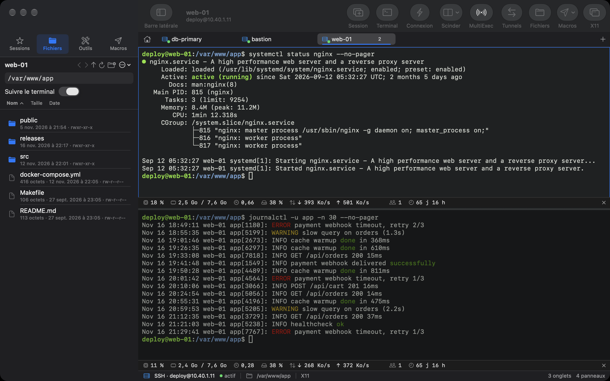
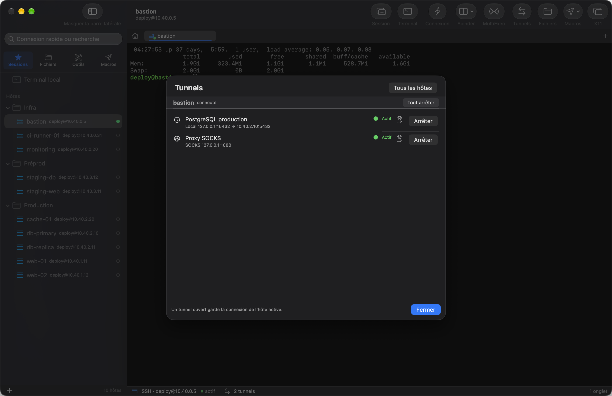
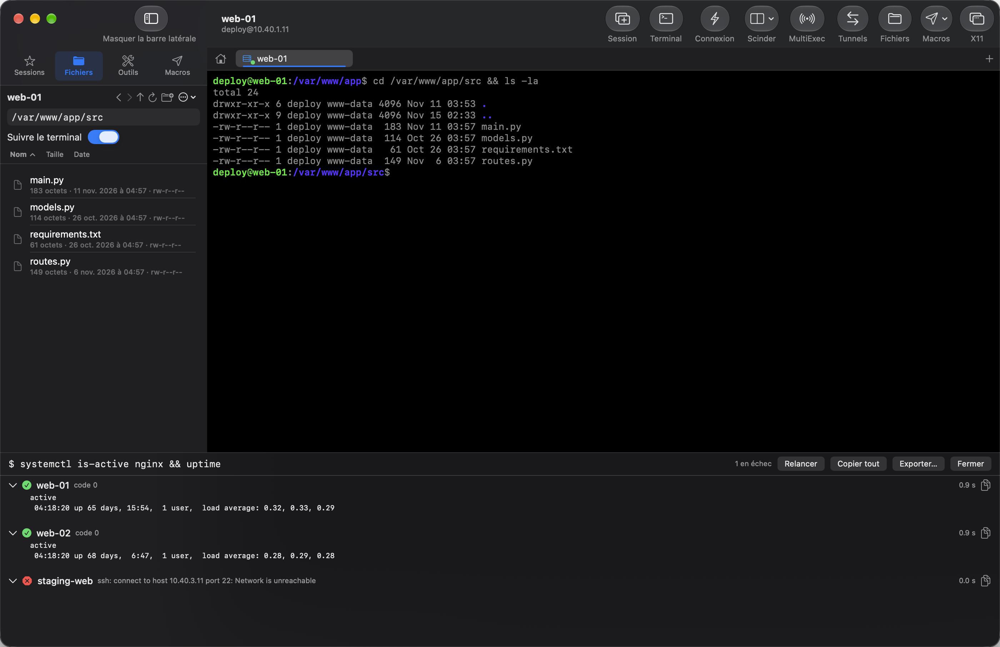

<div align="center">


# Escale

**Un client SSH gratuit et natif pour macOS : terminal, SFTP, tunnels et multi-exécution dans une seule fenêtre.**

[](LICENSE)


[Site](https://www.escalecompany.com) · [Télécharger](https://github.com/ATTILA-KRB/escale/releases/latest) · [Discussions](https://github.com/ATTILA-KRB/escale/discussions) · [English](README.md)



</div>

Escale est un gestionnaire de sessions pour celles et ceux qui vivent sur des machines distantes. Il pilote l'OpenSSH de
votre système (`/usr/bin/ssh`) via une seule connexion `ControlMaster` par hôte : votre `~/.ssh/config`, `ProxyJump`, les
agents SSH et les clés FIDO fonctionnent tels quels. La disposition rappellera MobaXterm ou Termius ; l'interface est
native (SwiftUI/AppKit). Pas de compte, pas d'abonnement, pas de télémétrie : hors vos propres connexions, Escale ne
contacte que son flux de mises à jour.

## Fonctionnalités

- **Terminal** à onglets, panneaux scindés, onglets détachables, mode compact, reconnexion automatique qui conserve
  l'écran et l'historique. Moteur : [SwiftTerm](https://github.com/migueldeicaza/SwiftTerm). Coloration optionnelle de la
  sortie (erreurs, avertissements, IP) sans jamais modifier les octets envoyés par le programme.
- **Fichiers (SFTP) à côté du shell** : un volet latéral qui ouvre le serveur sur la connexion déjà établie (pas de seconde
  authentification) et suit le dossier courant du terminal. Glisser-déposer depuis/vers le Finder, file de transferts, copie
  de serveur à serveur, édition de fichier distant (le fichier modifié en local est renvoyé à l'enregistrement), repli
  par le shell si le serveur n'a pas de SFTP.
- **Tunnels** : redirections locales, distantes et dynamiques (SOCKS) ouvertes sur la connexion active, IPv6, port attribué
  par le serveur, modification à chaud. Escale sonde le port avant d'afficher « actif » : une redirection refusée par le
  serveur ne passe jamais pour ouverte.
- **Multi-exécution** : diffusez votre saisie vers tous les panneaux d'un onglet, tous les onglets ou une sélection (sous un
  cadre rouge), ou lancez une commande sur un groupe d'hôtes en parallèle et lisez sortie, code de retour et durée par hôte.
  Les valeurs d'hôte sont échappées avant insertion.
- **Serveur X11 intégré** : lancez des applications graphiques distantes sans installer XQuartz ni saisir de mot de passe
  administrateur. Démarré à la demande, sans port réseau, mode non fiable par défaut.
- **Autres protocoles** : Telnet (tunnel SSH optionnel), port série (vitesse, parité, BREAK, DTR/RTS), VNC (client RFB natif,
  éventuellement via SSH), RDP (génère un fichier `.rdp` pour Windows App, éventuellement via tunnel SSH).
- **Macros** : enregistrez une suite de frappes et rejouez-la avec `⌃⌥1` à `⌃⌥9`, sur un panneau ou tous.
- **Supervision** : CPU, mémoire, charge, disque et débit sous le terminal, sans rien installer sur le serveur.
- **Connexion rapide** (`⇧⌘K`, `utilisateur@hôte:port`) et **import** depuis MobaXterm, PuTTY, CSV ou `~/.ssh/config`.

<p align="center">
  
  
</p>

### Sécurité

- Les secrets ne vivent que dans le Trousseau macOS, et seulement après une connexion réussie ; jamais dans un modèle, un
  fichier, un journal ou un message d'erreur.
- Une clé d'hôte modifiée est toujours refusée, jamais proposée comme simple confirmation.
- Escale n'écrit jamais dans `~/.ssh`.
- Les mots de passe parviennent à `ssh` par un assistant `SSH_ASKPASS` sur socket Unix privé.

## Téléchargement

Récupérez l'image disque notarisée la plus récente sur la [page des releases](https://github.com/ATTILA-KRB/escale/releases/latest)
(ou sur le [site](https://www.escalecompany.com)), ouvrez-la et glissez Escale dans Applications. Il faut **macOS 15 ou
plus récent** ; l'application est universelle (Apple silicon et Intel). Elle est signée Developer ID, notarisée par Apple et
se met à jour avec [Sparkle](https://sparkle-project.org). Elle n'est pas sur le Mac App Store : le bac à sable exclurait
l'OpenSSH du système et `~/.ssh/config`.

## Compiler depuis les sources

Prérequis : macOS 15+, Xcode avec Swift 6, [XcodeGen](https://github.com/yonaskolb/XcodeGen) (`brew install xcodegen`).

```sh
git clone https://github.com/ATTILA-KRB/escale.git
cd escale
scripts/test.sh                 # tests du cœur + build Debug de l'app
xcodegen generate && open Escale.xcodeproj
```

Remarques :

- Le premier build télécharge l'installeur officiel de XQuartz 2.8.6 (environ 120 Mo, SHA-256 figé) pour embarquer le
  serveur X11 ; il est mis en cache dans `~/Library/Caches/Escale-build`.
- Les builds Debug sont signés ad hoc et sans mises à jour (`ESCALE_FEED_URL` est vide par défaut).
- Signature, notarisation et DMG demandent votre propre Developer ID Apple : voir [docs/RELEASE.md](docs/RELEASE.md).
- Architecture, invariants et conventions : [AGENTS.md](AGENTS.md) ; décisions de conception : [docs/PLAN.md](docs/PLAN.md).
  L'interface est disponible en français et en anglais (langue du système). Les chaînes sont dans `Escale/Resources/Localizable.xcstrings` ; voir la section « Localisation » d'[AGENTS.md](AGENTS.md).

## Contribuer

Rapports de bugs, idées et pull requests sont les bienvenus : voir [CONTRIBUTING.md](CONTRIBUTING.md) et les
[Discussions](https://github.com/ATTILA-KRB/escale/discussions).

## Licence

Escale est un logiciel libre publié sous [licence GNU GPL v3.0](LICENSE). Copyright (C) 2026 Rayan Kroubi.

## Crédits

- [SwiftTerm](https://github.com/migueldeicaza/SwiftTerm) (MIT), émulation et rendu du terminal.
- [Sparkle](https://github.com/sparkle-project/Sparkle) (MIT), mises à jour.
- [XQuartz](https://www.xquartz.org) (licences X.Org, quartz-wm sous APSL-2.0), source du serveur X11 embarqué.
- OpenSSH, fourni par votre macOS.

Liste complète des licences : [THIRD_PARTY_NOTICES.md](THIRD_PARTY_NOTICES.md).
