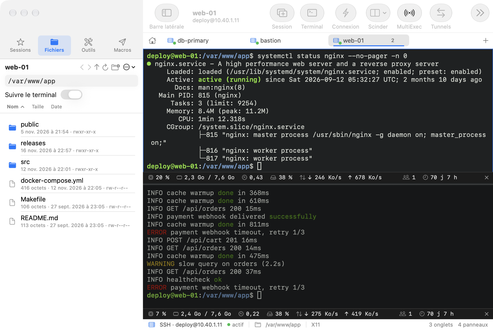
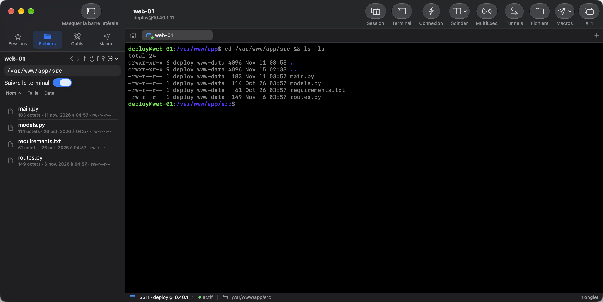
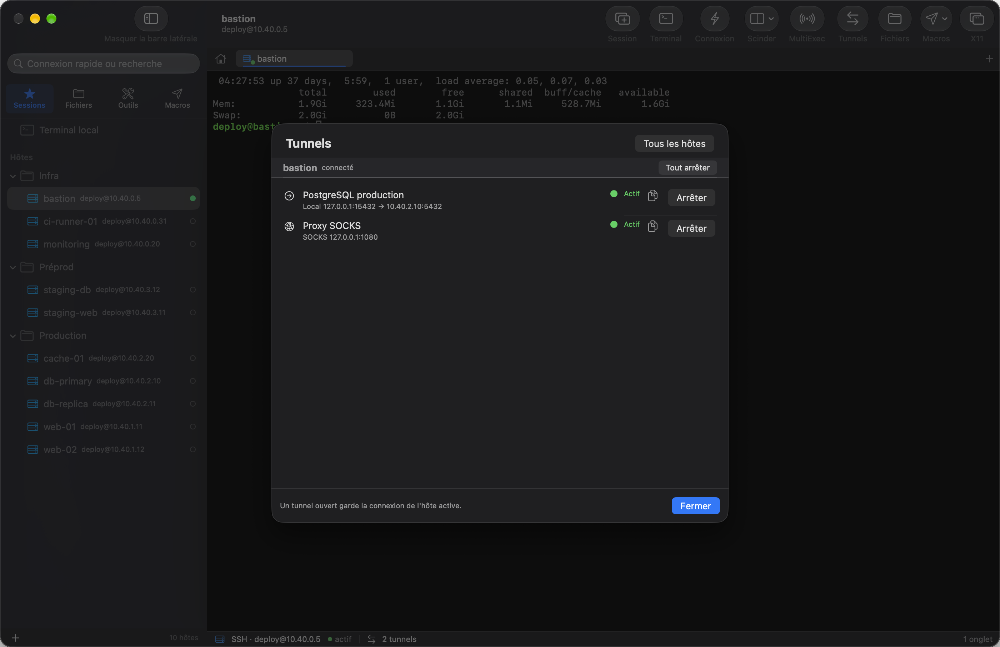
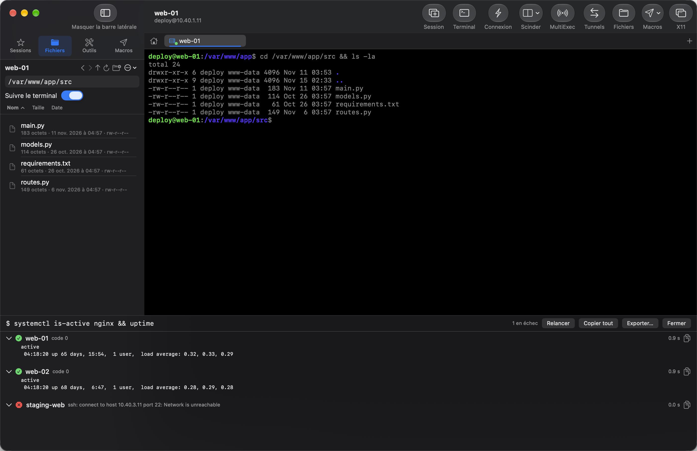
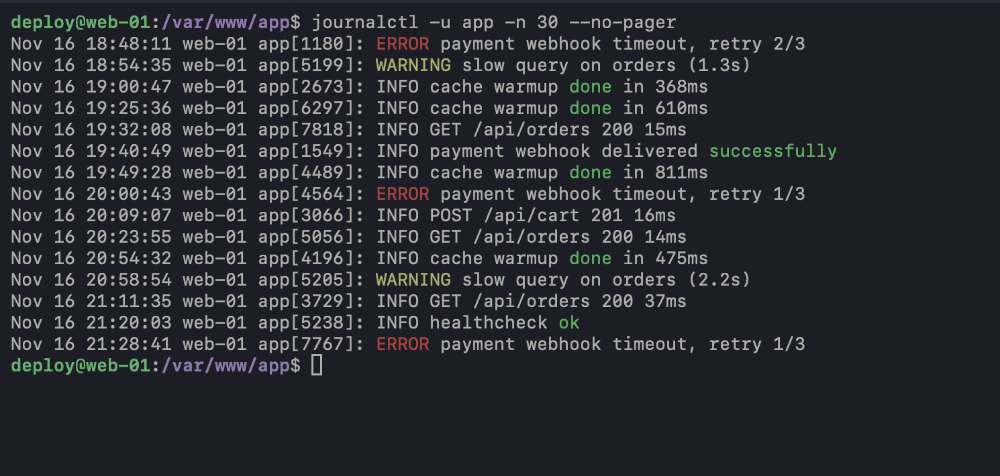
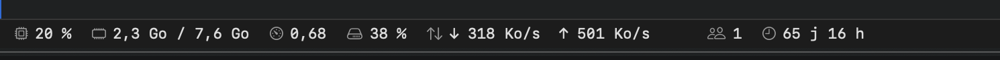
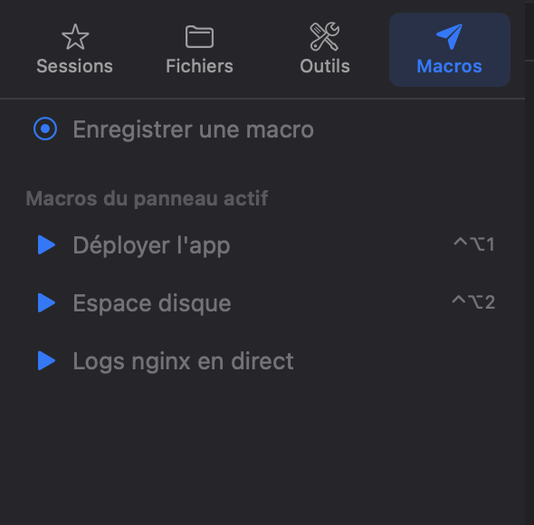
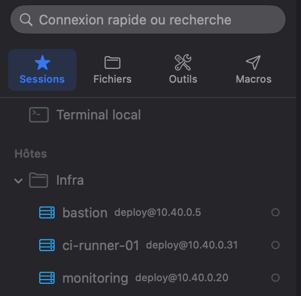
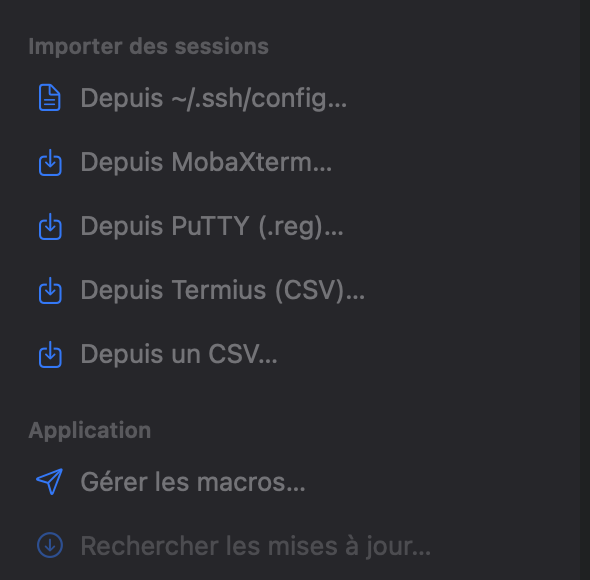
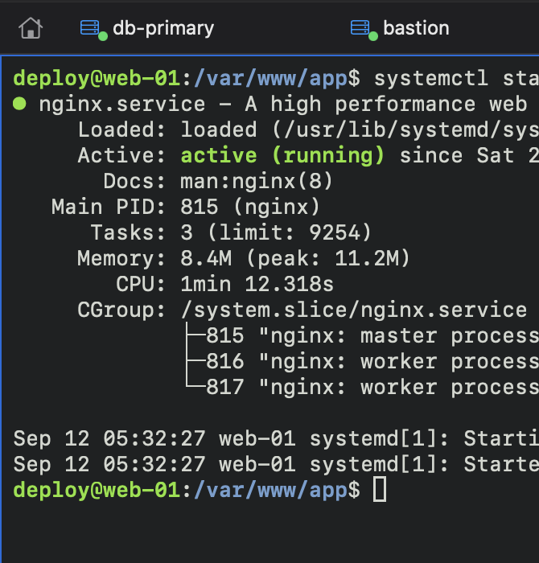

<div align="center">


# Escale

**A free, native SSH client for macOS: terminal, SFTP, tunnels and multi-execution in one window.**

[](LICENSE)


[Website](https://www.escalecompany.com) · [Download](https://github.com/ATTILA-KRB/escale/releases/latest) · [Discussions](https://github.com/ATTILA-KRB/escale/discussions) · [Français](README.fr.md)

<a href="docs/images/readme-hero.png"></a>

</div>

Escale is a session manager for people who live on remote machines. It drives your system's OpenSSH
(`/usr/bin/ssh`) through a single `ControlMaster` connection per host, so your `~/.ssh/config`, `ProxyJump`, SSH agents
and FIDO keys work as they are. The layout will feel familiar if you come from MobaXterm or Termius; the interface
is native SwiftUI/AppKit. The interface is available in **English and French** and follows the system language (screenshots below may still show the French UI).
No account, no subscription, no telemetry: apart from your own connections, Escale only contacts its update feed.

## Features

### Files beside the shell



A sidebar pane opens the server over the connection you already have (no second login) and follows the terminal's
current folder. Drag and drop from/to Finder, transfer queue, server-to-server copy, remote file editing (a locally
edited file is sent back when you save it), shell fallback when the server has no SFTP.

### Tunnels that tell the truth



Local, remote and dynamic (SOCKS) forwards opened on the live connection, IPv6, server-assigned ports, editable while
running. Escale probes the port before showing "active": a forward the server refused never passes for open.

### One keystroke, ten servers



Broadcast your typing to every pane of a tab, all tabs or a selection (under a red border), or run one command on a
group of hosts in parallel and read output, exit code and duration per host. Host values are shell-escaped before insertion.

### Terminal



Tabs, split panes, detachable tabs, compact mode, and automatic reconnection that keeps the screen and scrollback.
Engine: [SwiftTerm](https://github.com/migueldeicaza/SwiftTerm). Seven themes and optional output highlighting (errors,
warnings, IPs) that never alters the bytes the program sent.



**Monitoring**: CPU, memory, load, disk and throughput under the terminal, with nothing installed on the server.

### And everything else

<table>
  <tr>
    <td width="50%" valign="top"><br><b>Macros</b>: record a keystroke sequence and replay it with <code>⌃⌥1</code> to <code>⌃⌥9</code>, on one pane or all.</td>
    <td width="50%" valign="top"><br><b>Quick connect</b> (<code>⇧⌘K</code>, <code>user@host:port</code>): the host joins your library, sorted into folders.</td>
  </tr>
  <tr>
    <td width="50%" valign="top"><br><b>Import</b> from MobaXterm, PuTTY, Termius, CSV or <code>~/.ssh/config</code>.</td>
    <td width="50%" valign="top"><br><b>Tabs and panes</b>: split, detach a tab into its own window, switch to compact mode.</td>
  </tr>
</table>

- **Built-in X11 server**: run remote graphical apps without installing XQuartz or typing an admin password. Starts on
  demand, listens on no network port, untrusted mode by default.
- **Other protocols**: Telnet (optional SSH tunnel), serial ports (speed, parity, BREAK, DTR/RTS), VNC (native RFB client,
  optionally through SSH), RDP (generates a `.rdp` file for Windows App, optionally through an SSH tunnel).
- **AI agent access (MCP)**: let Claude Code, Cursor or any MCP client run commands, type into terminals, read and
  write files and drive tunnels on the hosts you choose, over the connections you already opened. Off by default, per-host
  level (read only, confirm each action, or free), local socket only, every call logged. See [docs/MCP.md](docs/MCP.md).

All screenshots come from a lab with fictitious servers.

### Security model

- Secrets live in the macOS Keychain only, and only after a successful login; never in a model, a file, a log or an error message.
- A changed host key is always refused, never offered as a simple confirmation.
- Escale never writes to `~/.ssh`.
- Passwords reach `ssh` through a private Unix-socket `SSH_ASKPASS` helper.

## Download

Grab the latest notarized disk image from the [Releases page](https://github.com/ATTILA-KRB/escale/releases/latest)
(or from the [website](https://www.escalecompany.com)), open it and drag Escale to Applications. Requires **macOS 15 or later**;
the app is a universal binary (Apple silicon and Intel). It is signed with a Developer ID and notarized by Apple, and
updates itself through [Sparkle](https://sparkle-project.org). It is not on the Mac App Store because the sandbox rules out
your system's OpenSSH and `~/.ssh/config`.

## Build from source

Requirements: macOS 15+, Xcode with Swift 6 support, [XcodeGen](https://github.com/yonaskolb/XcodeGen) (`brew install xcodegen`).

```sh
git clone https://github.com/ATTILA-KRB/escale.git
cd escale
scripts/test.sh                 # core tests + Debug build of the app
xcodegen generate && open Escale.xcodeproj
```

Notes:

- The first build downloads the official XQuartz 2.8.6 installer (about 120 MB, SHA-256 pinned) to embed the X11 server; it
  is cached in `~/Library/Caches/Escale-build`.
- Debug builds are ad-hoc signed and have updates disabled (`ESCALE_FEED_URL` is empty by default).
- Signing, notarization and DMG creation need your own Apple Developer ID: see [docs/RELEASE.md](docs/RELEASE.md)
  (written in French) and replace the identity and update-feed settings with yours.
- Architecture, invariants and conventions: [AGENTS.md](AGENTS.md); design decisions: [docs/PLAN.md](docs/PLAN.md).

## Contributing

Bug reports, ideas and pull requests are welcome: see [CONTRIBUTING.md](CONTRIBUTING.md) and the
[Discussions](https://github.com/ATTILA-KRB/escale/discussions).

## License

Escale is free software released under the [GNU General Public License v3.0](LICENSE). Copyright (C) 2026 Rayan Kroubi.

## Credits

- [SwiftTerm](https://github.com/migueldeicaza/SwiftTerm) (MIT), terminal emulation and rendering.
- [Sparkle](https://github.com/sparkle-project/Sparkle) (MIT), updates.
- [XQuartz](https://www.xquartz.org) (X.Org licenses, quartz-wm under APSL-2.0), source of the embedded X11 server.
- OpenSSH, from your macOS.

Full list of licenses: [THIRD_PARTY_NOTICES.md](THIRD_PARTY_NOTICES.md).
